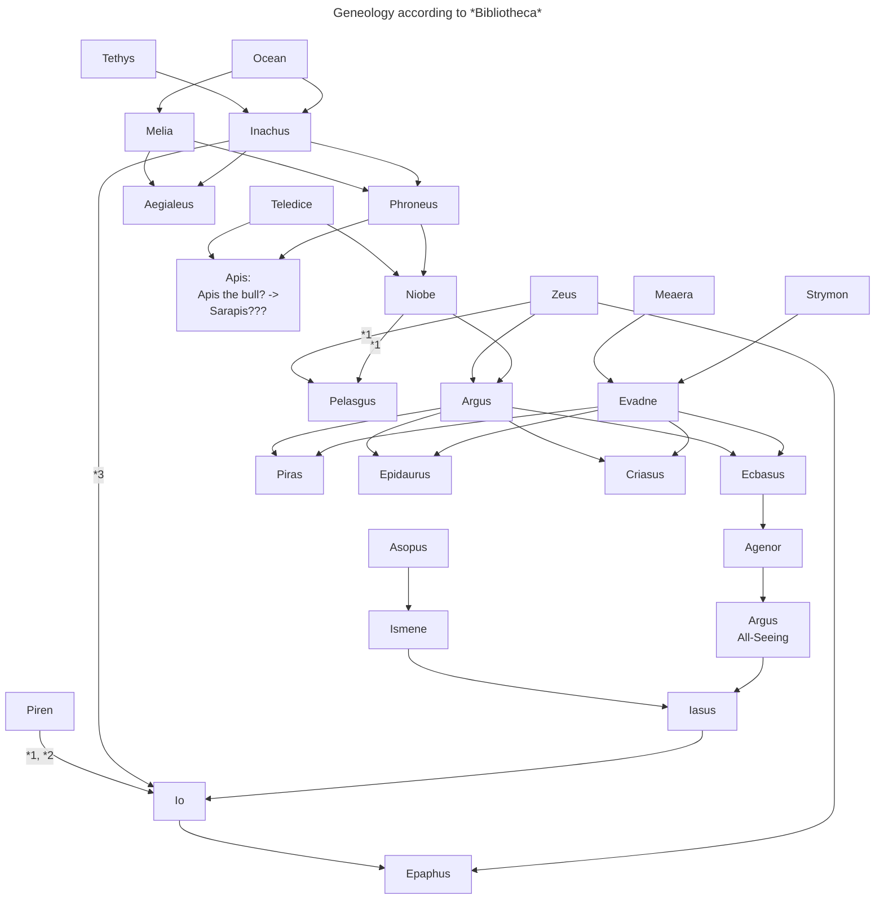

## Sources
[Pseudo-Apollodorus' *Bibliotheca* (Book 2)](https://www.theoi.com/Text/Apollodorus2.html) 

\*1: Acusilaus
\*2: Hesiod
\*3: Castor of Rhodes

>*...Argus, the one who is called the All-seeing. He had eyes in the whole of his body, and being exceedingly strong he killed the bull that ravaged Arcadia and clad himself in its hide; and when a satyr wronged the Arcadians and robbed them of their cattle, Argus withstood and killed him. It is said, too, that Echidna, daughter of Tartarus and Earth, who used to carry off passers-by, was caught asleep and slain by Argus. He also avenged the murder of Apis by putting the guilty to death.*

[Apollonius of Rhodes' *Argonautica*](https://www.loebclassics.com/display/apollonius_rhodes-argonautica/2009/pb_LCL001.13.xml) 

## Questions
__Bibliotheca__:
- Niobe: *cohabited*: slept with or lived with?
- Pelasgus: son of soil = Gaia?
- *Curetes*: Ancient people or Kouretes (Zeus protectors)?