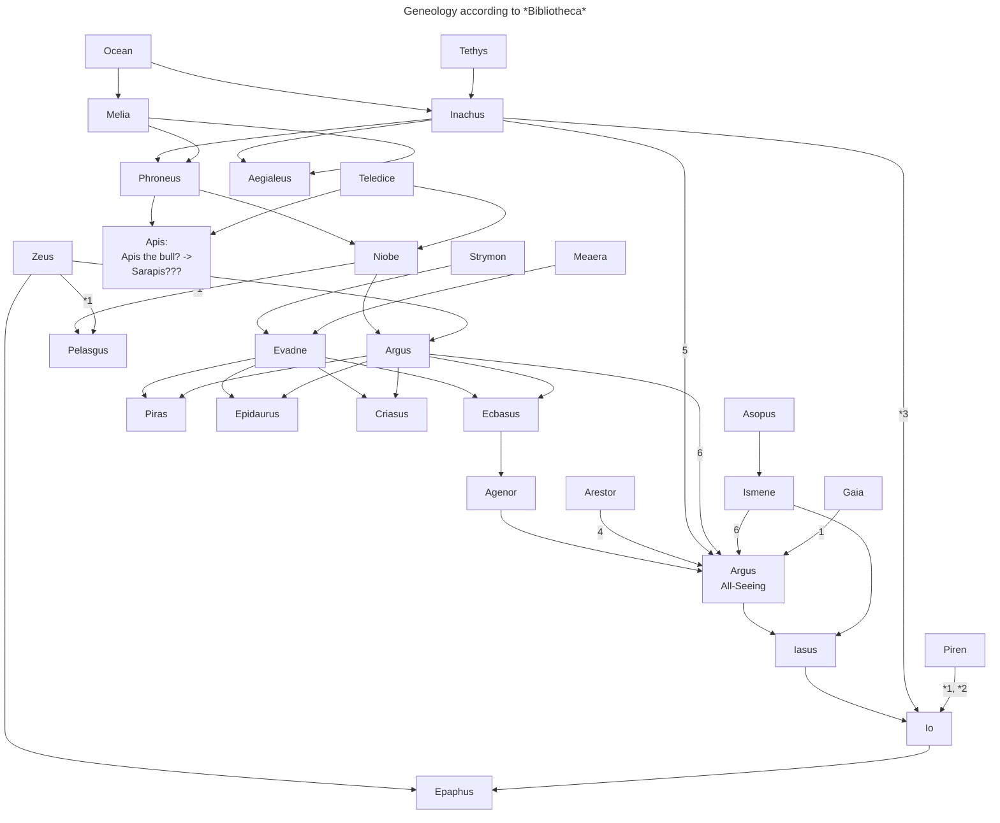

# Sources
## In Story
### [Pseudo-Apollodorus' *Bibliotheca* (Book 2)](https://www.theoi.com/Text/Apollodorus2.html) 

\*1: Acusilaus
\*2: Hesiod
\*3: Castor of Rhodes
\*4: Pherecydes
5: Asclepiades
6: Cercops

>*...Argus, the one who is called the All-seeing. He had eyes in the whole of his body, and being exceedingly strong he killed the bull that ravaged Arcadia and clad himself in its hide; and when a satyr wronged the Arcadians and robbed them of their cattle, Argus withstood and killed him. It is said, too, that Echidna, daughter of Tartarus and Earth, who used to carry off passers-by, was caught asleep and slain by Argus. He also avenged the murder of Apis by putting the guilty to death.*

>*...Hera requested the cow from Zeus for herself and set Argus the All-seeing to guard it.*

>*But Zeus ordered Hermes to steal the cow, and as Hermes could not do it secretly because Hierax had blabbed, he killed Argus by the cast of a stone; whence he was called Argiphontes.*

### [Apollonius of Rhodes' *Argonautica*](https://www.loebclassics.com/display/apollonius_rhodes-argonautica/2009/pb_LCL001.13.xml)

>*For she herself also fashioned the swift ship, and with her had Argus, son of Arestor, built it according to her instructions.*

>*Nor indeed did Acastus, the son of mighty Pelias himself, desire to remain in the palace of his father, nor did Argus, the goddess Athena’s assistant, but it turned out that even these two were to be included in the crew.*

Throughout the *Argonautica*, he is mainly a mechanic who is on board for the maintenance of the Argo

### [Aeschylus, Prometheus Bound 565 - 885](https://topostext.org/work/15#565)

*Argos* not *Argus*

>*The apparition of earth-born Argos – Ah! go away! – I’m afraid*
>*To look at the myriad-eyed herdsman!*
>*He goes along with sneaky eyes,*
>
>*Which even after they’ve died are not hidden by the earth.*
>*Coming from those underground he bloodhounds*
>*Me in my misery, and makes me wander*
>*Starving along the sands of the shore.*
>*His wax-moulded pipe shrills*
>
>*As it sounds a soporific tune.*

>*With a sharp-mouthed gadfly, leaping about madly*  
>*I rushed to the well-watered stream of Kerchneia*
>*And the spring of Lerne. But the earthborn herdsman*
>*Argos accompanied my untempered passion, watching*
>*Over my steps with his clustered eyes.*
>
>*But then an unexpected and sudden fate*
>*Deprived him of life. I goad-struck*
>*By a divine whip am now driven from country to country.*

### [Scholiast annotation on a footnote in Hesiod's\/Cercops of Miletus' *Aegimius*](https://topostext.org/work/7#MS.F5)
>*IO Scholiast on Eurip, Phoen. 1116: "And (Hera) set a watcher upon her (Io), great and strong (Argus), who with four eyes looks every way. And the goddess stirred in him unwearying strength: sleep never fell upon his eyes; but he kept sure watch always."*

### [Scholiast annotation on a footnote in Homer's ...?](https://topostext.org/work/7#MS.F6)
>*IO Scholiast on Homer, Il. xxiv. 24: “Slayer of Argus.” According to Hesiod's tale he (Hermes) slew (Argus) the herdsman of Io.*
### [Heracleitus' *On Unbelievable Tales*](https://topostext.org/work/851#37)
>*Panoptes: People invented the idea that Panoptes, because he was eager to see and listen in on everything, had eyes covering his whole body. As a result, we still even now call people who are inquisitive in this way ‘panoptic.’*

### [Euripides' *Phoenician Women*](https://topostext.org/work/47#1109)
### Ovid
#### [*Metamorphoses*]
>*Juno regardful of Jove's cunning art, lest he might change her to her human form, gave the unhappy heifer to the charge of Argus, Aristorides, whose head was circled with a hundred glowing eyes; of which but two did slumber in their turn whilst all the others kept on watch and guard. Whichever way he stood his gaze was fixed on Io — even if he turned away his watchful eyes on Io still remained.*
>
>*There is a grove in Thessaly, enclosed on every side with crags, precipitous, — on which a forest grows — and this is called the Vale of Tempe — through this valley flows the River Peneus, white with foaming waves, that issue from the foot of Pindus, whence with sudden fall up gather steamy clouds that sprinkle mist upon the circling trees, and far away with mighty roar resound. It is the abode, the solitary home, that mighty River loves, where deep in gloom of rocky cavern, he resides and rules the flowing waters and the water nymphs abiding there. All rivers of that land now hasten thither, doubtful to console or flatter Daphne's parent: poplar crowned Sperchios, swift Enipeus and the wild Amphrysos, old Apidanus and Aeas, with all their kindred streams that wandering maze and wearied seek the ocean. Inachus alone is absent, hidden in his cave obscure, deepening his waters with his tears — most wretchedly bewailing, for he deems his daughter Io lost. If she may live or roam a spirit in the nether shades he dares not even guess but dreads.*
>
>*For Jove not long before had seen her while returning from her father's stream, and said; 'O virgin, worthy of immortal Jove, although some happy mortal's chosen bride, — behold these shades of overhanging trees, and seek their cool recesses while the sun is glowing in the height of middle skies — 'and as he spoke he pointed out the groves — 'But should the dens of wild beasts frighten you, with safety you may enter the deep woods, conducted by a God — not with a God of small repute, but in the care of him who holds the heavenly scepter in his hand and fulminates the trackless thunder bolts. — forsake me not!' For while he spoke she fled, and swiftly left behind the pasture fields of Lerna, and Lyrcea's arbours, where the trees are planted thickly. But the God called forth a heavy shadow which involved the wide extended earth, and stopped her flight and ravished in that cloud her chastity.*
>
>*Meanwhile, the goddess Juno gazing down on earth's expanse, with wonder saw the clouds as dark as night enfold those middle fields while day was bright above. She was convinced the clouds were none composed of river mist nor raised from marshy fens. Suspicious now, from oft detected amours of her spouse, she glanced around to find her absent lord, and quite convinced that he was far from heaven, she thus exclaimed; 'This cloud deceives my mind, or Jove has wronged me.' From the dome of heaven she glided down and stood upon the earth, and bade the clouds recede. But Jove had known the coming of his queen. He had transformed the lovely Io, so that she appeared a milk white heifer — formed so beautiful and fair that envious Juno gazed on her. She queried: 'Whose? what herd? what pasture fields?' As if she guessed no knowledge of the truth. And Jupiter, false hearted, said the cow was earth begotten, for he feared his queen might make inquiry of the owner's name. Juno implored the heifer as a gift. — what then was left the Father of the Gods? 'Twould be a cruel thing to sacrifice his own beloved to a rival's wrath. Although refusal must imply his guilt the shame and love of her almost prevailed; but if a present of such little worth were now denied the sharer of his couch, the partner of his birth, 'twould prove indeed the earth born heifer other than she seemed — and so he gave his mistress up to her.*
>
>*Juno regardful of Jove's cunning art, lest he might change her to her human form, gave the unhappy heifer to the charge of Argus, Aristorides, whose head was circled with a hundred glowing eyes; of which but two did slumber in their turn whilst all the others kept on watch and guard. Whichever way he stood his gaze was fixed on Io — even if he turned away his watchful eyes on Io still remained. He let her feed by day; but when the sun was under the deep world he shut her up, and tied a rope around her tender neck. She fed upon green leaves and bitter herbs and on the cold ground slept — too often bare, she could not rest upon a cushioned couch. She drank the troubled waters. Hoping aid she tried to stretch imploring arms to Argus, but all in vain for now no arms remained; the sound of bellowing was all she heard, and she was frightened with her proper voice. Where former days she loved to roam and sport, she wandered by the banks of Inachus: there imaged in the stream she saw her horns and, startled, turned and fled. And Inachus and all her sister Naiads knew her not, although she followed them, they knew her not, although she suffered them to touch her sides and praise her. When the ancient Inachus gathered sweet herbs and offered them to her, she licked his hands, kissing her father's palms, nor could she more restrain her falling tears. If only words as well as tears would flow, she might implore his aid and tell her name and all her sad misfortune; but, instead, she traced in dust the letters of her name with cloven hoof; and thus her sad estate was known.*
>
>*'Ah wretched me! ' her father cried; and as he clung around her horns and neck repeated while she groaned, 'Ah wretched me! Art thou my daughter sought in every clime? When lost I could not grieve for thee as now that thou art found; thy sighs instead of words heave up from thy deep breast, thy longings give me answer. I prepared the nuptial torch and bridal chamber, in my ignorance, since my first hope was for a son in law; and then I dreamed of children from the match: but now the herd may furnish thee a mate, and all thy issue of the herd must be. Oh that a righteous death would end my grief! — it is a dreadful thing to be a God! Behold the lethal gate of death is shut against me, and my growing grief must last throughout eternity.' While thus he moaned came starry Argus there, and Io bore from her lamenting father. Thence he led his charge to other pastures; and removed from her, upon a lofty mountain sat, whence he could always watch her, undisturbed.*
>
>*The sovereign god no longer could endure to witness Io's woes. He called his son, whom Maia brightest of the Pleiades brought forth, and bade him slay the star eyed guard, Argus. He seized his sleep compelling wand and fastened waving wings on his swift feet, and deftly fixed his brimmed hat on his head: — lo, Mercury, the favoured son of Jove, descending to the earth from heaven's plains, put off his cap and wings, — though still retained his wand with which he drove through pathless wilds some stray she goats, and as a shepherd fared, piping on oaten reeds melodious tunes. Argus, delighted with the charming sound of this new art began; 'Whoever thou art, sit with me on this stone beneath the trees in cooling shade, whilst browse the tended flock abundant herbs; for thou canst see the shade is fit for shepherds.'*
>
>*Wherefore, Mercury sat down beside the keeper and conversed of various things — passing the laggard hours. — then soothly piped he on the joined reeds to lull those ever watchful eyes asleep; but Argus strove his languor to subdue, and though some drowsy eyes might slumber, still were some that vigil kept. Again he spoke, (for the pipes were yet a recent art) 'I pray thee tell what chance discovered these.'*
>
>*To him the God, ' A famous Naiad dwelt among the Hamadryads, on the cold Arcadian summit Nonacris, whose name was Syrinx. Often she escaped the Gods, that wandered in the groves of sylvan shades, and often fled from Satyrs that pursued. Vowing virginity, in all pursuits she strove to emulate Diana's ways: and as that graceful goddess wears her robe, so Syrinx girded hers that one might well believe Diana there. Even though her bow were made of horn, Diana's wrought of gold, vet might she well deceive. 'Now chanced it Pan. Whose head was girt with prickly pines, espied the Nymph returning from the Lycian Hill, and these words uttered he' — But Mercury refrained from further speech, and Pan's appeal remains untold. If he had told it all, the tale of Syrinx would have followed thus: — but she despised the prayers of Pan, and fled through pathless wilds until she had arrived the placid Ladon's sandy stream, whose waves prevented her escape. There she implored her sister Nymphs to change her form: and Pan, believing he had caught her, held instead some marsh reeds for the body of the Nymph; and while he sighed the moving winds began to utter plaintive music in the reeds, so sweet and voice like that poor Pan exclaimed; 'Forever this discovery shall remain a sweet communion binding thee to me.' — and this explains why reeds of different length, when joined together by cementing wax, derive the name of Syrinx from the maid.*
>
>*Such words the bright god Mercury would say; but now perceiving Argus' eyes were dimmed in languorous doze, he hushed his voice and touched the drooping eyelids with his magic wand, compelling slumber. Then without delay he struck the sleeper with his crescent sword, where neck and head unite, and hurled his head, blood dripping, down the rocks and rugged cliff. Low lies Argus: dark is the light of all his hundred eyes, his many orbed lights extinguished in the universal gloom that night surrounds; but Saturn's daughter spread their glister on the feathers of her bird, emblazoning its tail with starry gems.*
>
>*Juno made haste, inflamed with towering rage, to vent her wrath on Io; and she raised in thought and vision of the Grecian girl a dreadful Fury. Stings invisible, and pitiless, she planted in her breast, and drove her wandering throughout the globe. The utmost limit of her laboured way, O Nile, thou didst remain. Which, having reached, and placed her tired knees on that river's edge, she laid her there, and as she raised her neck looked upward to the stars, and groaned and wept and mournfully bellowed: trying thus to plead, by all the means she had, that Jupiter might end her miseries. Repentant Jove embraced his consort, and entreated her to end the punishment: 'Fear not,' he said, 'For she shall trouble thee no more.' He spoke, and called on bitter Styx to hear his oath.*
>
>*And now imperial Juno, pacified, permitted Io to resume her form, — at once the hair fell from her snowy sides; the horns absorbed, her dilate orbs decreased; the opening of her jaws contracted; hands appeared and shoulders; and each transformed hoof became five nails. And every mark or form that gave the semblance of a heifer changed, except her fair white skin; and the glad Nymph was raised erect and stood upon her feet. But long the very thought of speech, that she might bellow as a heifer, filled her mind with terror, till the words so long forgot for some sufficient cause were tried once more.*
>
>*And since that time, the linen wearing throng of Egypt have adored her as a God; for they believe the seed of Jove prevailed; and when her time was due she bore to him a son called Epaphus; who also dwells in temples with his mother in that land. Now Phaethon, whose father was the Sun, was equal to his rival, Epaphus, in mind and years; and he was glad to boast of wonders, nor would yield to Epaphus for pride of Phoebus, his reputed sire. Unable to endure it, Io's son thus mocked him; 'Poor, demented fellow, what will you not credit if your mother speaks, you are so puffed up with the fond conceit of your imagined sire, the Lord of Day.'*

*Aristorides*/*Arestorides*: Son of Arestor
### [*On Love*]
### [Hyginus' *Fabulae*](https://topostext.org/work/206#145)

### [Tzetze's *Ad Lyncophronem*](https://topostext.org/work/860#836)

### [Cicero's *Nature of the Gods*](https://topostext.org/work/137#3.55)

### [*Suda Encyclopedia*](https://topostext.org/work/240#pi.2506)

### [Hesychius](https://topostext.org/work/801#6)

### [Malalas' *Chronography*](https://topostext.org/work/793#4.69)
>*In these years there were among the Hellenes Prometheus, Epimetheus, Atlas, and all-seeing Argus called the hundred-eyed because he was looked at by all sides, and was fierce,*
>
>*and Deucalion, the son of Hellen son of Picus. Argus discovered craftsmanship in the western parts*

## Art
## [LIMC](https://app.dasch.swiss/project/BRwvcfLLT72IN-fXzQkrdQ/advanced-search?q=Argus)
### Naples National Archaeological Museum
#### [17694](https://app.dasch.swiss/resource/080E/9QhD-sgWULacZ-lZ9pdZwA)
#### [17696](https://app.dasch.swiss/resource/080E/n1bxEy14Vo-V_dDuCFxYug)
#### [4103](https://app.dasch.swiss/resource/080E/CpwZjDVPVCWR64nhmd79JQ)
#### 
## Scholarly Essays/Books
### [Ten Thousand Eyes: The Story of Ἄργος Μυριωπός](https://www.academia.edu/22563153/Ten_Thousand_Eyes_The_Story_of_%E1%BC%8C%CF%81%CE%B3%CE%BF%CF%82_%CE%9C%CF%85%CF%81%CE%B9%CF%89%CF%80%CF%8C%CF%82?utm_source=chatgpt.com)

### [A Web of Fantasies: Gaze, Image, and Gender in Ovid's Metamorphoses \(Chapter 2\)](https://muse.jhu.edu/book/28257)

## Misc.
### [Theoi](https://www.theoi.com/Gigante/GiganteArgosPanoptes.html)
### [Oxford Classical Dictionary](https://www.oxfordreference.com/display/10.1093/acref/9780199545568.001.0001/acref-9780199545568-e-717)
>*((1) RE 18), son of Zeus and the Argive Niobe (daughter of Phoroneus), eponym of the city of Argos (1) (Apollod. 2. 1. 1), part of archaic Argive mythological propaganda. His grave, not far from that of his ‘brother’ Pelasgus (Paus. 2. 22, cf. Apollod. 2. 1. 1–2), was in a dense sacred grove (Hdt. 6. 78–80). ((2) RE 19) Argos ‘Panoptes’ (‘All-seeing’), monster born of no agreed parents—perhaps even earthborn (Aesch. PV 567), with multiple eyes: four (the Aegimius, Hes. fr. 294 M–W), an extra eye in the back of the head and unsleeping (Pherec. FGrH 3 F 67), or covered in eyes (Eur. Phoen. 1116, perhaps Aesch. PV 678). Hera has him guard Io, but he is tricked and killed by Hermes, who thus acquires his epithet ‘Argeiphontes’ (supposedly ‘Argos-slayer’, already in Hes. Catalogus mulierum, fr. 126 M–W). In later tradition, at death he turns into a peacock (Moschus 2. 58) or his eyes are added to its plumage (Ov. Met. 1. 722). ((3) RE 20) An Argonaut, builder of the Argo (Ap. Rhod. 1. 19, 226; Diod. Sic. 4. 41. 3), a favourite of Roman artists, LIMC 2/1 (1984), 600–2. ((4) RE 27) ‘Swift’, Odysseus’ dog (Od. 17. 291).*

RE: Paulys Realencyclopädie der classischen Altertumswissenschaft
Paus: Pausinias
Hdt: Herodotus
Aesch. PV: Aeschylus' Prometheus Vinctus (Bound)
## Questions
__Bibliotheca__:
- Niobe: *cohabited*: slept with or lived with?
- Pelasgus: son of soil = Gaia?
- *Curetes*: Ancient people or Kouretes (Zeus protectors)?
- "Lover's oaths do not draw down the anger of the gods": ???
__Prometheus Bound__:
- Argus is chasing her with a gadfly even after death?
- Argus --> Other Argus the craftsman?
	- Allegory or 